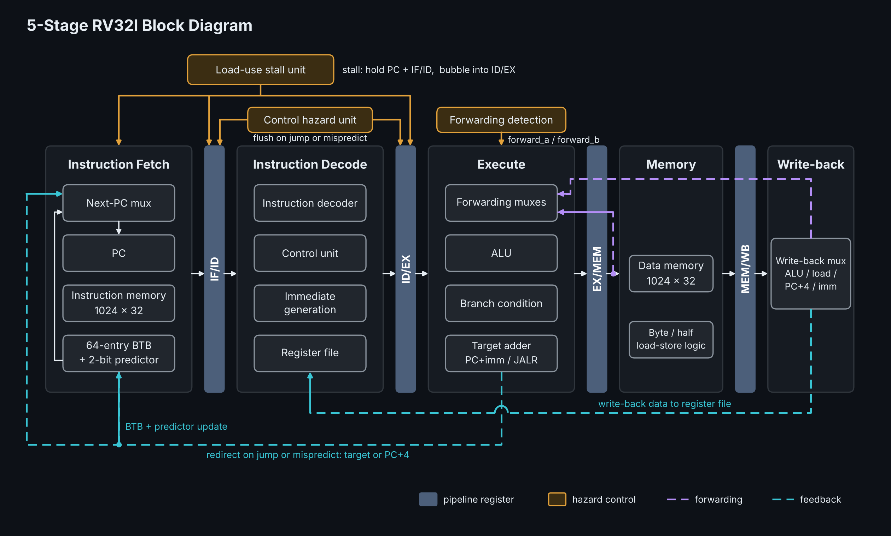
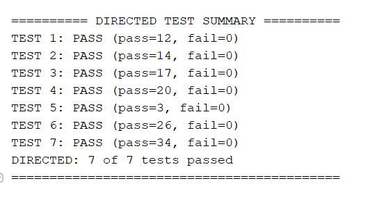
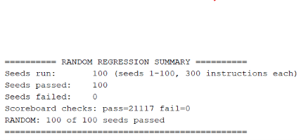
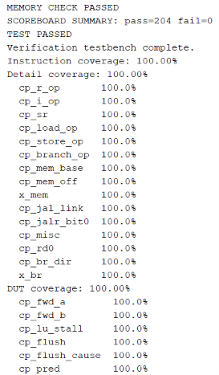
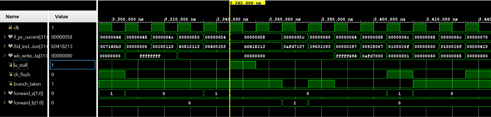
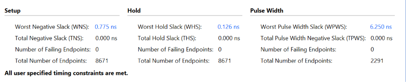

# 5-Stage Pipelined RV32I Processor with Verification and FPGA Implementation

## Overview

A 32-bit RISC-V (RV32I) processor with a classic five-stage pipeline (IF, ID, EX, MEM, WB), written in SystemVerilog. The design was verified in Vivado XSim with a class-based, UVM-style testbench, then synthesized and implemented in Vivado 2025.2 for the Xilinx Artix-7 xc7a100tcsg324-1 (Nexys A7-100T). It has not been programmed onto hardware.

## Block Diagram

## Microarchitecture

- **Data hazards:** Operands are forwarded to EX from the EX/MEM and MEM/WB stages.
- **Load-use hazards:** A stall unit holds the PC and IF/ID for one cycle and inserts a bubble into ID/EX when an instruction in ID depends on a load in EX.
- **Control hazards:** Jumps and mispredicted branches are resolved in EX. The two younger instructions in IF/ID and ID/EX are flushed, and the PC is redirected to the correct target (or PC+4).
- **Branch prediction:** A 2-bit saturating counter predictor works with a 64-entry direct-mapped branch target buffer (BTB), indexed by `pc[7:2]` and tagged with `pc[31:8]`. Both are updated from EX when a branch resolves.
- **Instruction memory:** A dedicated write port (`we`, `waddr`, `wdata`) lets the testbench load each program.

## Verification Methodology

The testbench is built from plain SystemVerilog classes that follow UVM's layered structure without using the UVM library: a sequencer, driver, monitor, golden reference model, scoreboard, and coverage collector.

- **Constrained-random testing:** Random programs cover every RV32I instruction format. The golden model predicts each register write, and the scoreboard checks the DUT's write-backs against it in order.
- **Directed tests:** Seven fixed programs target corner cases that random generation rarely hits, such as load-use stalls, partial (byte/halfword) stores, shift-amount boundaries, and BTB aliasing.
- **Functional coverage:** Three covergroups track instruction types, 15 detail items, and 6 DUT-level events (forwarding on each operand, load-use stalls, flushes, flush causes, and branch prediction).

| Test | Result |
|---|---|
| Random regression | 100 / 100 seeds pass (300 instructions each, 21,117 register writes checked, 0 mismatches) |
| Directed tests | 7 / 7 pass |
| Functional coverage | 100% instruction, detail, and DUT coverage (seed 1) |

Coverage is reported for a single seed because coverage is not merged across seeds.

### Simulation Evidence

The per-seed results for all 100 random seeds are in [docs/regress_results.txt](docs/regress_results.txt).

## Synthesis and Implementation

Synthesis and implementation were run out of context (OOC) with a 15 ns clock constraint.

| Metric | Result |
|---|---|
| Slice LUTs | 2,489 (3.93%) |
| Slice registers | 1,701 (1.34%) |
| Block RAM | 1 tile (0.74%) |
| DSP | 0 |
| Worst setup slack | +0.775 ns |
| Worst hold slack | +0.126 ns |

Timing is met at 15 ns (66.7 MHz), which puts the estimated maximum frequency at about 70 MHz. The data memory maps to LUT RAM. Because the run is out of context, these timing results cover the CPU core only, not board I/O.

The critical path runs from the forwarding select through the ALU comparison to `branch_taken`, and then into the ID/EX flush. About 78% of its delay is routing, mostly from the flush signal fanning out to every ID/EX field. A possible improvement is to flush only the control fields instead of the whole register. This has not been implemented.

## Repository Structure

| Path | Contents |
|---|---|
| `rtl/` | Processor RTL (pipeline stages, pipeline registers, hazard units, branch predictor, BTB) |
| `testbench/` | Top-level verification testbench |
| `verification/` | Class-based verification environment (sequencer, driver, monitor, golden model, scoreboard, coverage) |
| `constraints/` | XDC timing constraint |
| `docs/` | Block diagram, simulation evidence, regression results, utilization, timing, and critical path reports |
| `cpu_project1/` | Vivado project and regression scripts |
| `program.hex` | Default instruction memory image |

## Reproducing the Results

1. Open `cpu_project1/cpu_project1.xpr` in Vivado 2025.2 and run a behavioral simulation. Use `+SEED=<n> +N=<count>` for a random program or `+TEST=<1-7>` for a directed test.
2. For the full regressions, run `source -notrace regress.tcl` (100 random seeds) or `source -notrace regress_directed.tcl` (7 directed tests) from the `cpu_project1/` folder in the Tcl console. Each script prints a pass/fail summary at the end, and `regress.tcl` also writes `regress_results.txt`.
3. To reproduce the implementation numbers, run synthesis and implementation with `cpu_pipeline` as the top module. The reports are saved in `docs/`.

## License

This project is licensed under the MIT License. See [LICENSE](LICENSE) for details.